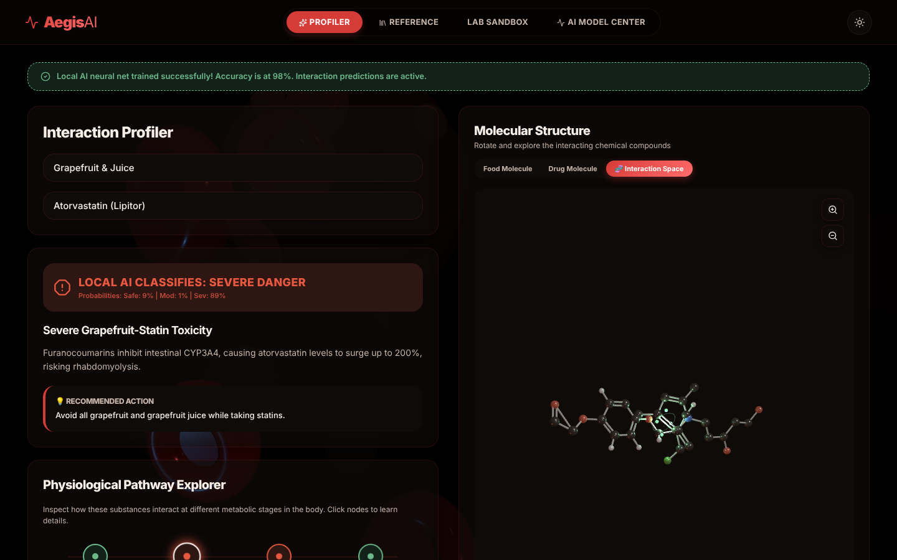
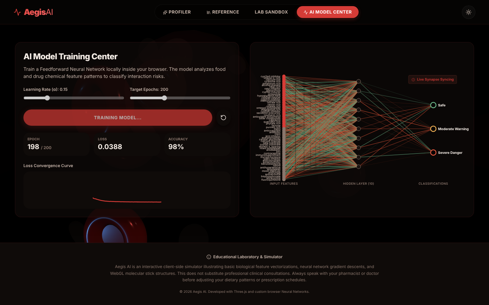

# Aegis AI: Food and Drug Interaction Profiler

A browser app that predicts whether a food and a medicine are likely to interact (safe, moderate warning, or severe danger). The prediction comes from a small neural network written from scratch in JavaScript and trained live in the browser, with 3D molecule views built in Three.js.



> **Educational project.** This is a learning simulator, not medical advice. Always ask a doctor or pharmacist about food and medicine interactions.

## Features

- **Interaction Profiler:** pick a food and a drug to get class probabilities, the mechanism behind the interaction, a recommended action, and a rotatable 3D view of the molecules involved.
- **Reference:** browse the labelled food and drug interactions and open any of them in the profiler.
- **Lab Sandbox:** design a hypothetical compound by ticking pharmacological markers or entering a SMILES string, then see how the model classifies it.
- **AI Model Center:** train the network in the browser, change the learning rate and epoch count, and watch the loss curve, accuracy and connection weights update.
- Light and dark themes.



## How it works

**Data.** The dataset has 54 foods and 49 drugs, giving 2,646 food and drug pairs. Each food is encoded as 30 binary pharmacological features (for example CYP3A4 inhibitor, vitamin K rich, tyramine rich) and each drug as 30 binary class features (for example statin, anticoagulant, MAOI). 102 pairs are labelled as known interactions (58 moderate, 44 severe), and every other pair is treated as safe. The dataset is curated in `scripts/generate_dataset.py`, which writes it out as a JavaScript module.

**Model.** A feedforward network with 60 inputs, one hidden layer of 10 sigmoid units, and a 3-class softmax output. It is trained with cross-entropy loss and per-sample gradient descent. Forward pass, backpropagation and weight updates are implemented by hand in about 200 lines of plain JavaScript (`src/utils/neuralNet.js`), with no ML library.

**Molecules.** `src/utils/smiles.js` parses SMILES strings into an atom and bond graph and computes a force-directed 3D layout, which Three.js renders as a ball-and-stick model.

## Results

Measured with the app's default settings (200 epochs, learning rate 0.15) over 5 training runs:

| Metric | Value |
| --- | --- |
| Accuracy on all 2,646 pairs | 97.9% to 98.2% |
| Baseline (always predict "safe") | 96.2% |
| Recall on severe interactions | 68% to 96% |
| Recall on moderate interactions | 55% to 95% |

These numbers are measured on the same pairs the model trains on, so they show how well the network fits the dataset, not how well it generalises. The dataset is heavily imbalanced (2,544 of 2,646 pairs are safe), which is why recall on the two warning classes matters more than overall accuracy.

## Limitations and next steps

- Evaluate on a held-out split of foods and drugs instead of the training pairs.
- Handle class imbalance (class weighting or resampling) to make recall on severe interactions more stable between runs.
- SMILES feature detection uses simple substring rules and covers only part of the feature set.
- Labels are hand-curated for teaching purposes and are not a clinical reference.

## Tech stack

| Area | Tools |
| --- | --- |
| Frontend | React 19, Vite 8 |
| 3D graphics | Three.js |
| Model | Custom neural network in plain JavaScript |
| Dataset tooling | Python 3 |
| Linting | Oxlint |

## Run locally

Requires Node.js 20.19 or newer.

```bash
git clone https://github.com/saitej-1/drug-food-intraction-platfrom.git
cd drug-food-intraction-platfrom/food-drug-interact-app
npm install
npm run dev
```

Then open the local URL that Vite prints. To make a production build, run `npm run build`.

To regenerate the dataset after editing the food, drug or interaction lists:

```bash
python3 scripts/generate_dataset.py
```

This writes `src/data/interactions_generated.js`.

## Project structure

```
.
├── index.html                    # Standalone animated landing page (Three.js + GSAP)
├── docs/screenshots/             # Images used in this README
└── food-drug-interact-app/       # The React app
    ├── scripts/
    │   └── generate_dataset.py   # Curated dataset and JS generator
    └── src/
        ├── App.jsx               # Tabs, theme, training loop
        ├── components/           # Profiler, Reference, Sandbox, Model Center, 3D canvas
        ├── data/                 # Foods, drugs, labelled interactions, molecules
        └── utils/
            ├── neuralNet.js      # Network, backpropagation, training data builder
            └── smiles.js         # SMILES parser and 3D layout
```

## Author

**Sai Tej**, B.Tech Computer Science and Engineering, Keshav Memorial College of Engineering, Hyderabad.
